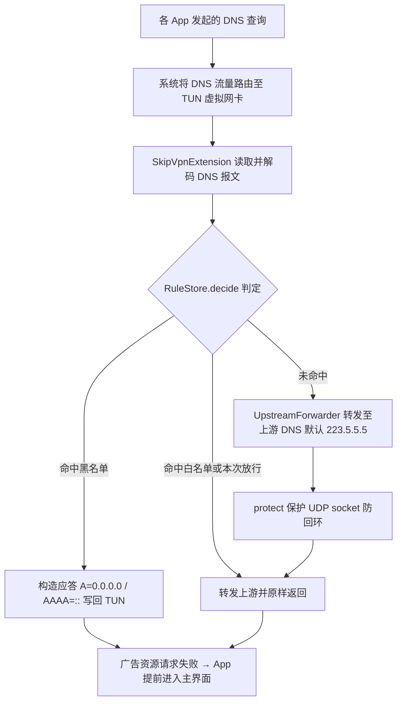

# 开屏广告拦截 · HarmonyOS NEXT 本地 DNS 拦截工具

> 让开屏广告的**资源请求失败**，使 App 提前进入主界面 —— 不识别按钮、不注入点击，靠「网络层拦截」而非「模拟点击跳过」。

[](#)
[](#)
[](#)
[](#)

---

## 目录

- [项目简介](#项目简介)
- [核心价值主张](#核心价值主张)
- [目标用户群体](#目标用户群体)
- [技术方案与整体架构](#技术方案与整体架构)
  - [工作原理](#工作原理)
  - [整体架构](#整体架构)
  - [目录结构](#目录结构)
- [主要功能特点](#主要功能特点)
- [使用指南](#使用指南)
  - [环境要求](#环境要求)
  - [获取源码](#获取源码)
  - [配置本地环境](#配置本地环境)
  - [构建与打包](#构建与打包)
  - [安装与运行](#安装与运行)
  - [基础使用](#基础使用)
- [规则管理（进阶）](#规则管理进阶)
- [隐私与权限](#隐私与权限)
- [注意事项与已知限制](#注意事项与已知限制)
- [项目状态与路线图](#项目状态与路线图)
- [许可证](#许可证)
- [相关文档](#相关文档)

---

## 项目简介

**开屏广告拦截**是一款面向 **HarmonyOS NEXT** 的真机工具，采用「本地 VPN 接管设备 DNS ＋ 按规则拦截广告域名」的思路，让开屏广告所需的图片／视频等资源请求**直接失败**，从而促使目标 App 跳过等待、提前进入主界面。

它与市面上「无障碍自动点击跳过」类工具走的是两条完全不同的路线：本工具**不依赖无障碍权限、不模拟点击、不识别界面按钮**，因此不会触发应用对模拟操作的检测与风控，也不会因界面改版而失效。代价是：它只能拦截「走独立广告域名」的第三方 SDK 开屏广告，对「广告素材与投放都在 App 自有域」的一方自有广告无效（详见[注意事项](#注意事项与已知限制)）。

> ⚠️ 本项目以 **debug 包侧载**方式运行，**未上架**任何应用市场；是个人自托管／调试用途的开源工程，请在遵守当地法律法规与厂商协议的前提下使用。

## 核心价值主张

- **不打扰、不越权**：仅申请 `INTERNET` 权限，VPN 能力通过系统 `VpnExtensionAbility` 授权弹窗获取，不申请无障碍、不申请任何隐私敏感权限。
- **本地优先、零上传**：DNS 查询在设备内部按规则判定，**不解密、不上传**任何流量内容；上游解析服务器地址可配置，默认指向公共 DNS。
- **不怕界面改版**：基于网络层拦截，与开屏页的 UI 结构、按钮位置无关，App 更新界面也不会失效。
- **规则热更新**：规则以 `rules.json` 文件化存储，修改后下一次 DNS 查询即生效，**无需重编译、重新装机或重启 VPN**。
- **安全默认（fail-open）**：任何规则未命中或解析异常一律放行，绝不误杀用户的正常 DNS，避免「拦错导致上不了网」。

## 目标用户群体

| 用户类型 | 是否适合 | 说明 |
|---|---|---|
| 被开屏广告困扰的 HarmonyOS NEXT 真机用户 | ✅ 适合 | 愿意开启开发者模式、侧载 debug 包、接受 VPN 常开 |
| 想自托管 DNS 拦截、自定义规则的进阶用户 | ✅ 适合 | 可在规则页增删域名、导入导出、一键加黑 |
| HarmonyOS / ArkTS 开发者 | ✅ 适合 | 代码分层清晰（纯函数核心／适配层／UI），含 237 项单测，可作为 VPN＋DNS 拦截的参考实现 |
| 不愿侧载、无开发者环境的小白 | ⚠️ 暂不适合 | 需真机调试环境；建议等上架或他人打包的分发渠道 |
| 期望「一键去掉所有开屏广告」的用户 | ⚠️ 需预期管理 | 一方自有广告无法在网络层拦截，详见限制 |

## 技术方案与整体架构

### 工作原理

应用启动时创建一个 **TUN 虚拟网卡**并接管设备的 DNS 流量。所有 App 发出的 DNS 查询被读入后解码，按「本次放行 ＞ 白名单 ＞ 黑名单」的顺序判定：

- **命中黑名单**：直接构造应答（A 记录回 `0.0.0.0`、AAAA 记录回 `::`），写回 TUN，使广告资源请求失败；
- **未命中 / 命中白名单 / 本次放行**：通过 `UpstreamForwarder` 转发到上游 DNS（默认 `223.5.5.5`），并用 `protect()` 保护 UDP socket 防止流量被自身 VPN 回环捕获；超时则返回 `SERVFAIL`。

由于广告资源加载失败，目标 App 通常会提前结束开屏等待、进入主界面。

### 整体架构



跨进程（主进程与 VPN 扩展进程）之间，**只有应用沙箱文件是共同真相源**，通过文件轮询实现状态与规则同步：

| 文件 | 写方 | 读方 | 用途 |
|---|---|---|---|
| `rules.json` | 主进程（诊断页放行）／扩展（种子、清空） | 扩展（500ms 节流热重载） | 规则热更新、本次放行 |
| `vpn_state.json` | 扩展 | 首页 | 真实运行状态、启动失败码 |
| `diag.json` | 扩展（2 秒节流） | 诊断页 | 计数、TopN、最近查询、收包分项、DoH 计数 |
| `grades.json` | 效果分级页 | 效果分级页 | A/B/C/D/E 人工分级与分层统计 |
| `pause.json` | 首页（暂停按钮） | 首页轮询 | 暂停截止时间，到点自动恢复 |
| `onboarded.json` | 首页引导弹层 | 首页 | 首次说明只显示一次 |

### 目录结构

```
entry/src/main/ets/
├── entryability/EntryAbility.ets    应用入口；处理通知栏「停止拦截」意图（onCreate / onNewWant）
├── pages/Index.ets                  主页：启停、暂停、首次引导、三页入口、真实状态轮询
├── pages/Diagnostics.ets            诊断页：统计 / TopN 一键加黑 / 最近查询 / 本次放行 / DoH 提示
├── pages/Rules.ets                  规则管理：增删改、启停、域名测试、导入导出（走系统文件选择器）
├── pages/Grades.ets                 效果分级：手动 App 标签、A/B/C/D/E 记录与分层统计
├── vpnextension/SkipVpnExtension.ets  VPN 主链路、通知动作按钮、异常通知、状态与快照落盘
├── core/DnsCodec.ets                纯函数：DNS 报文解析与应答构造（含 AAAA）
├── core/DomainRules.ets             纯函数：规则匹配、白名单优先、会话放行判定
├── core/DiagStats.ets               纯函数：计数、TopN、收包分项、DoH 计数
├── core/RuleSchema.ets              纯函数：导入导出、FNV-1a32 checksum、字段校验
├── core/GradeStats.ets              纯函数：分级聚合与分层口径
├── config/TargetApps.ets            编译期默认规则种子、上游与超时常量
├── config/RuleStore.ets             规则文件化、热重载、CRUD、本次放行
├── config/GradeStore.ets            分级记录持久化
├── common/VpnState.ets              跨进程 VPN 状态读写
├── common/PauseState.ets            暂停截止时间读写
├── common/OnboardState.ets          首次引导标记
├── common/Logger.ets                HiLog 封装
└── net/UpstreamForwarder.ets        上游 UDP 转发、事务 ID 重映射、protect
```

> 架构决策（为何选 DNS 拦截而非重打包／代理／无障碍）详见 [`docs/ADR-001-DNS拦截架构决策.md`](docs/ADR-001-DNS拦截架构决策.md)。

## 主要功能特点

- ✅ **本地 VPN ＋ DNS 拦截**：建 TUN、v4/v6 解析、命中拦截、上游转发、`protect()` 防回环，均已真机验证。
- ✅ **规则文件化与热更新**：`rules.json` 驱动，改完下一次查询即生效，不需重编译／装机／重启 VPN。
- ✅ **规则管理 UI**：黑白名单增删改、启停、域名连通性测试、导入导出（均走系统文件选择器，含 FNV-1a32 checksum 校验）。
- ✅ **诊断页**：实时统计、转发 TopN 一键加黑、最近查询、本次放行（误伤兜底，停 VPN 即清空）、DoH 提示。
- ✅ **效果分级面板**：手动标注各 App 的 A/B/C/D/E 拦截效果，分层统计覆盖率。
- ✅ **暂停 10 分钟**：临时放行全部域名，到点自动恢复 VPN。
- ✅ **真实 VPN 状态**：跨进程 `vpn_state.json` ＋ 3 秒轮询，启动失败显示错误码，杜绝「假运行中」。
- ✅ **通知栏「停止拦截」**：WantAgent 回 EntryAbility 触发 `stopVpnExtensionAbility`，无需回到 App。
- ✅ **首次引导**：首次打开说明能力边界与权限，仅显示一次。
- ✅ **异常通知 ＋ VPN 冲突提示**：扩展进程异常时系统通知告警；检测到与其它 VPN 冲突时给出提示。
- ✅ **空闲降频**：连续无包时轮询 10ms → 100ms 退避，有包立刻恢复，降低待机开销。
- ✅ **分层桌面图标**：符合华为 UX 规范（前景／背景各 1024×1024，方案「盾内快进」）。
- ✅ **单元测试**：**237 项全过**（纯函数核心层，本地 `bash test/run.sh` 即可运行）。

## 使用指南

### 环境要求

| 项目 | 要求 |
|---|---|
| 开发工具 | DevEco Studio 26.0.1 或更高版本 |
| SDK | HarmonyOS NEXT SDK（API 12 – 23，含 `hvigorw`／`ohpm`／`hdc`） |
| 运行设备 | **HarmonyOS NEXT 真机**（VPN 扩展无法在模拟器调试）；需开启「开发者模式」与「USB 调试」 |
| 权限 | 设备安装 debug 包需开发者模式；运行仅需系统 VPN 授权弹窗 |
| 网络 | 构建与运行均不依赖外网（纯本地） |

### 获取源码

通过 `git` 克隆本仓库，或从 GitHub 页面下载源码压缩包后解压：

```bash
# 克隆（请将 <你的用户名> 替换为实际仓库地址）
git clone https://github.com/<你的用户名>/harmony-splash-skip.git
cd harmony-splash-skip
```

### 配置本地环境

1. **签名配置（重要）**：本项目**不内置**任何签名文件（`.sign/` 目录已加入 `.gitignore`，含证书与密码，禁止入库）。首次构建可用 DevEco Studio 自动生成的 debug 签名；如需自有证书，可在本地放置 `sign-config.json5`（其优先级高于 `build-profile.json5`）。
2. **命令行环境变量**：`hvigorw` 与 `ohpm` 不在系统 `PATH` 中，需通过环境变量显式指定 SDK／JBR／Node 路径。以下为 **macOS 示例**，请按你的 DevEco Studio 实际安装位置调整（Linux／Windows 用户替换为对应路径）：

   ```bash
   export DEVECO_SDK_HOME=/Applications/DevEco-Studio.app/Contents/sdk
   export DEVECO_JAVA_HOME=/Applications/DevEco-Studio.app/Contents/jbr
   export NODE_HOME=/Applications/DevEco-Studio.app/Contents/tools/node
   ```

3. **设备连接**：用 USB 连接真机，确认 `hdc` 可识别设备：

   ```bash
   HDC=$HOME/Library/OpenHarmony/Sdk/23/toolchains/hdc   # 或你的 SDK 实际路径
   "$HDC" list targets
   ```

### 构建与打包

在项目根目录执行 `hvigorw` 打 debug HAP 包：

```bash
# 已配置上述三个环境变量后
/Applications/DevEco-Studio.app/Contents/tools/hvigor/bin/hvigorw \
  assembleHap --mode module -p product=default -p buildMode=debug --no-daemon
```

构建成功后，产物位于：

```
entry/build/default/outputs/default/entry-default-signed.hap
```

> 提示：若使用 DevEco Studio 图形界面，直接「Build → Build Hap(s)/APP(s) → Build Hap」亦可，效果相同。

### 安装与运行

将生成的 HAP 安装到已连接的真机并启动：

```bash
HDC=$HOME/Library/OpenHarmony/Sdk/23/toolchains/hdc   # 或你的 SDK 实际路径

# 安装（覆盖已装版本）
"$HDC" install -r entry/build/default/outputs/default/entry-default-signed.hap

# 启动入口 Ability（bundleName 见 AppScope/app.json5）
"$HDC" shell aa start -a EntryAbility -b com.liuqi.splashskip
```

### 基础使用

1. 在设备上打开本应用，首页点击「**启动拦截**」；
2. 系统弹出 **VPN 授权**对话框，点击允许；
3. 授权后首页状态变为「运行中」，即可正常打开其它 App —— 第三方 SDK 开屏广告将因资源请求失败而提前跳过；
4. 需要临时关闭时：可用首页「暂停 10 分钟」，或通知栏的「停止拦截」按钮，或返回应用点击停止；
5. 想查看拦截效果或管理规则，进入「诊断」「规则」「分级」三个页面（见下）。

## 规则管理（进阶）

- **增删域名**：规则页支持黑白名单的添加、删除、启停，以及「域名连通性测试」。
- **热更新**：所有改动写入 `rules.json`，扩展进程 500ms 内热重载，**下一次 DNS 查询即生效**，无需重启 VPN。
- **本次放行（误伤兜底）**：诊断页输入域名可执行「本次放行」，仅对当前会话有效，停止 VPN 后清空。
- **导入／导出**：规则页通过系统文件选择器导入／导出 `rules.json`，导入时做 `schemaVersion` 与 FNV-1a32 checksum 校验，损坏文件会被拒绝并提示。
- **TopN 一键加黑**：诊断页「转发 Top10」每行带「加黑」按钮，点击即加入黑名单。
- **上游 DNS**：默认转发至 `223.5.5.5`，可在 `entry/src/main/ets/config/TargetApps.ets` 中修改（仅作首次种子，运行期以 `rules.json` 为准）。

## 隐私与权限

- **权限最小化**：仅声明 `ohos.permission.INTERNET`；VPN 能力通过系统 `VpnExtensionAbility` 授权弹窗获取，不申请无障碍、通讯录、位置等任何敏感权限。
- **本地处理、零上传**：所有 DNS 判定在设备内完成，**不解密应用流量、不上传任何数据**；仅按 DNS 协议将查询转发至你**可配置**的上游解析服务器。
- **数据留存**：运行期仅在应用沙箱内生成上述状态文件（规则、诊断计数等），不上云、不共享。
- 完整说明见 [`docs/隐私政策.md`](docs/隐私政策.md)。

## 注意事项与已知限制

- 🟡 **仅对第三方 SDK 开屏广告有效**：一方自有广告（广告素材与投放都在 App 自有域，如平安好车主、中国联通）在 DNS 层无下手处，**请勿硬拦其业务主域**（如 `pingan.com.cn`／`10010.com`），否则会破坏登录与话费查询。这类广告不计入拦截效果分母。
- 🟡 **VPN 常开**：工具运行期间设备 DNS 由本 VPN 接管，与**其它 VPN／游戏加速器互斥**；停止本工具后系统 DNS 恢复正常。
- 🟡 **未上架市场**：以 debug 包侧载运行，需设备开启开发者模式；正式上架分发前仍需准备隐私合规材料（如隐私政策公网托管、应用商店数据安全表单）。许可证已采用 MIT（见 [`LICENSE`](LICENSE)）。
- 🟢 **fail-open 安全默认**：任何异常一律放行，不会因规则问题导致设备断网。
- 🟢 **分层图标规范**：`foreground/background` 各 1024×1024、背景不透明、不自带圆角；AppScope 与 entry 同名资源会编译覆盖，故 AppScope 资源统一加 `app_` 前缀。

## 项目状态与路线图

**当前状态**：第一、第二梯队功能已全部完成，单元测试 **237 项全过**，核心链路（建 TUN、v4/v6 解析、命中拦截、上游转发、防回环）均经真机验证。

**已知遗留（验证类）**：

- 第三方聚合 SDK 样本仍不足 3–5 款，分级面板会显示「样本不足暂不判定」；
- `0.0.0.0` 与 `NXDOMAIN` 两种应答策略的多轮复验；
- 连续 24 小时稳定性、待机 1 小时耗电、误拦回归；
- 异常通知与 VPN 冲突提示目前为代码级＋编译验证，尚未人工注入异常路径实测。

**路线图**：补齐第三方 SDK 样本 → 稳定性／功耗压测 → 探索更高覆盖率的放行策略（`isInternal`／`trustedApplications`）。

## 许可证

本项目采用 **MIT 许可证**，完整条款见仓库根目录的 [`LICENSE`](LICENSE) 文件（版权人 `gujin03`）。你可以在遵守 MIT 条款的前提下自由使用、修改与分发本项目，只需在副本中保留原许可证与版权声明。

## 相关文档

| 文档 | 说明 |
|---|---|
| [`docs/ADR-001-DNS拦截架构决策.md`](docs/ADR-001-DNS拦截架构决策.md) | 为何选 DNS 拦截而非重打包／代理／无障碍 |
| [`docs/开发差距分析.md`](docs/开发差距分析.md) | 需求对照与功能开发清单（第一／第二梯队） |
| [`docs/真机PoC验证手册.md`](docs/真机PoC验证手册.md) | 真机验证步骤与命令 |
| [`docs/隐私政策.md`](docs/隐私政策.md) | 隐私政策文本 |
| [`docs/代码质量检查报告.md`](docs/代码质量检查报告.md) | 质量／性能／安全／隐私合规检查与修复记录 |
| [`CHANGELOG.md`](CHANGELOG.md) | 版本变更记录 |
| [`design/icon/README.md`](design/icon/README.md) | 分层桌面图标设计与生成脚本 |

---

*本工程为个人自托管／调试用途的开源实现，使用即表示你理解并自行承担由此带来的设备与合规风险。*
